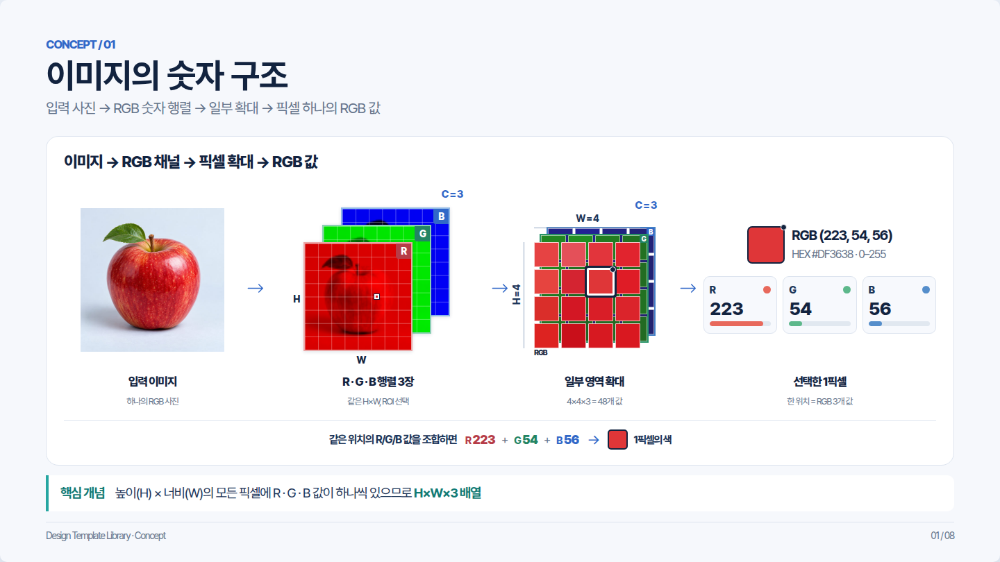
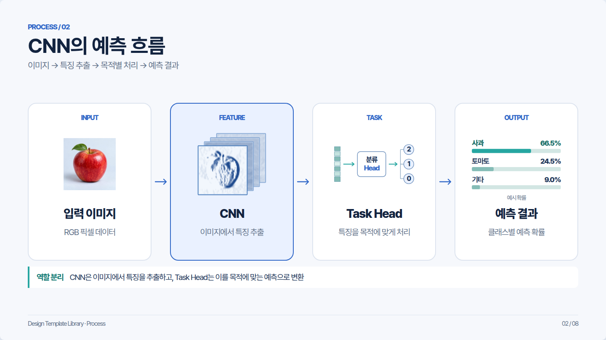
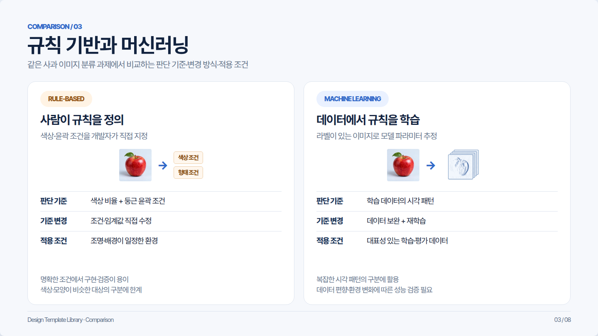
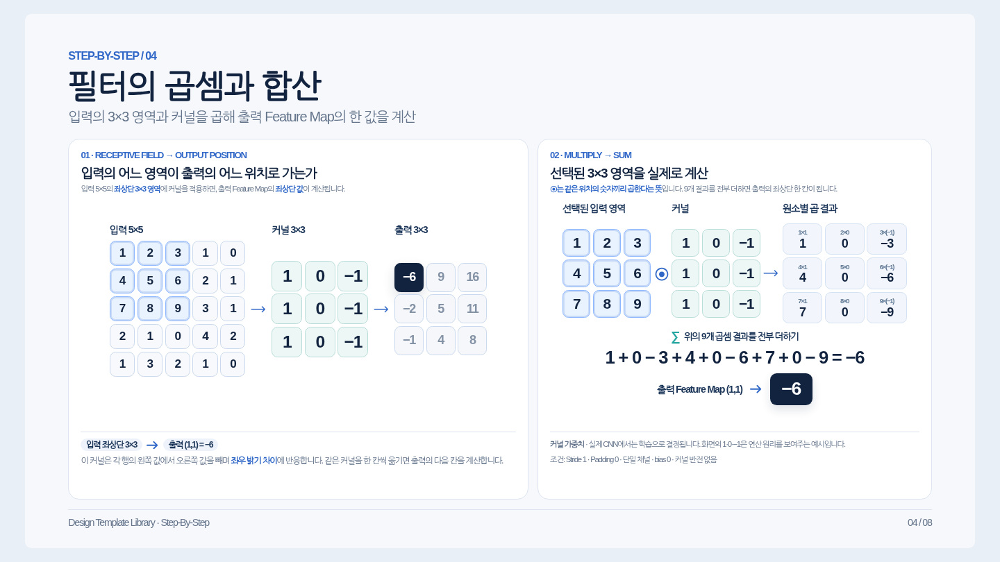
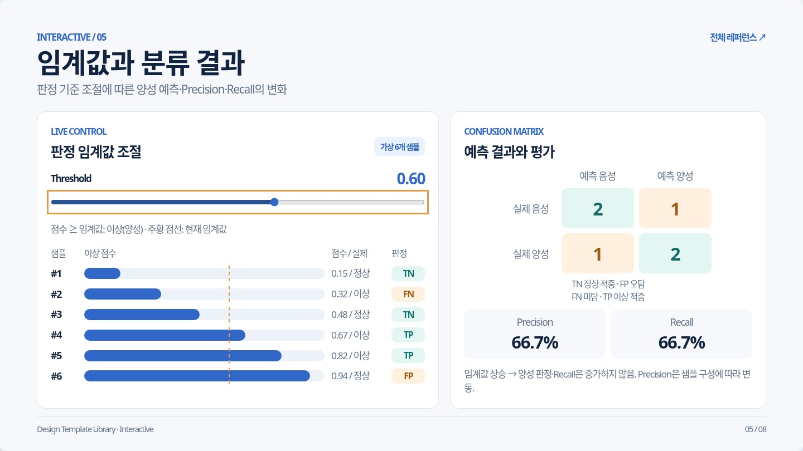
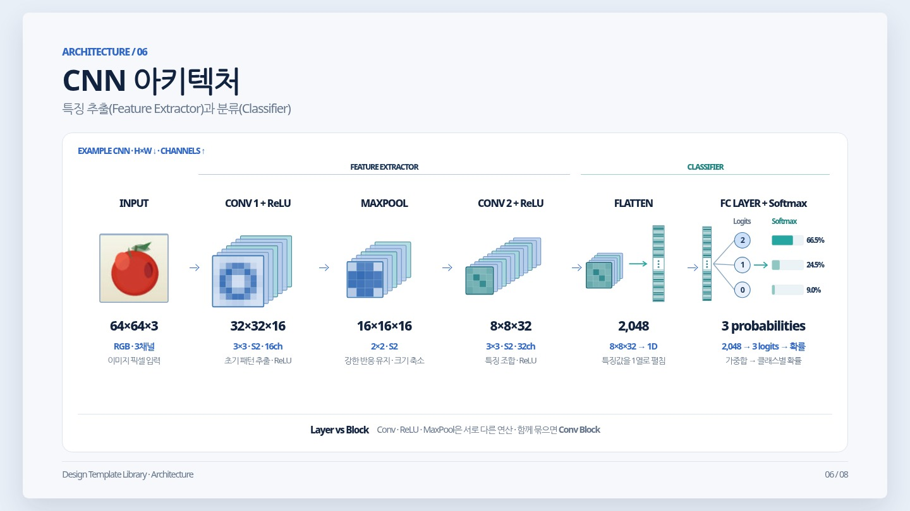
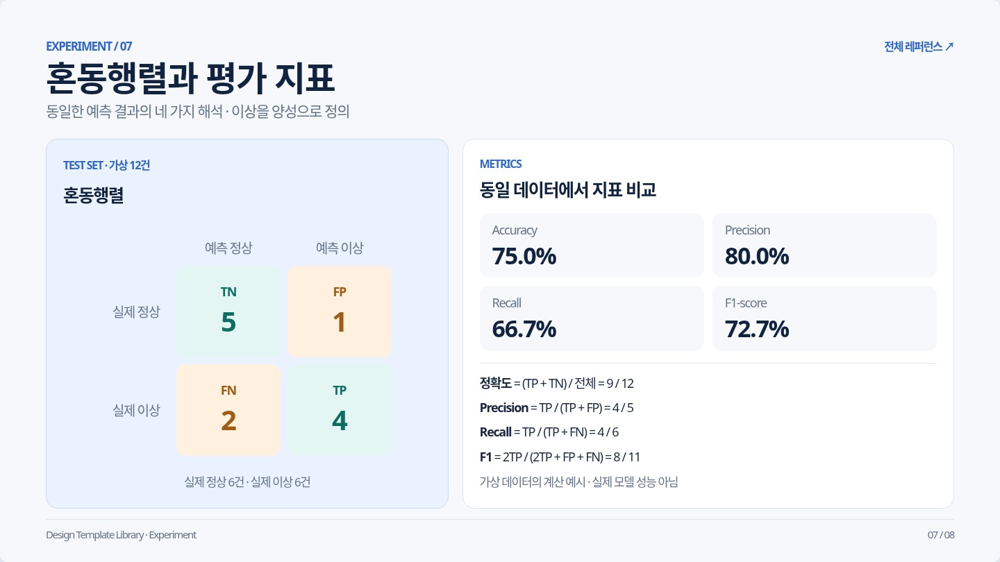
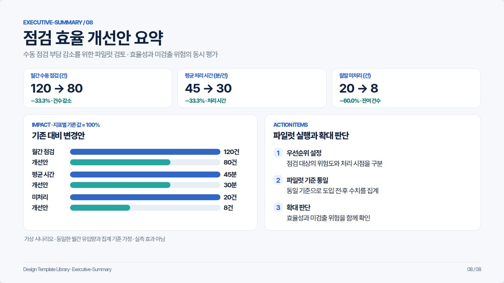

# Design Template Catalog · 8 HTML Reference Patterns

**2026-10-21 Concept / Architecture 개선:** Concept은 **왼쪽 흰색 외부 카드 섹션을 유지**하면서 사진 자체에 붙은 추가 배경·테두리·그림자를 제거했습니다. 사진의 80×80 리샘플 결과에서 선택된 실제 4×4 픽셀값을 Canvas로 가져오며, 확대 셀·RGB·HEX 값이 동일한 이미지 데이터에 연결됩니다. Architecture는 **단일 RGB 이미지(64×64×3)** → Conv1 **S2로 공간 축소·16채널(32×32×16)** → MaxPool **채널 유지·공간 축소(16×16×16)** → Conv2 **S2로 공간 축소·32채널(8×8×32)** → Flatten **1D 벡터(2,048)** → FC Layer **3 logits** → Softmax **3개 클래스 확률**을 논문형 도식으로 표현합니다. Softmax 확률값은 예시 logits [2, 1, 0]에서 계산한 값이며 실제 사진에 대한 모델 예측 결과는 아닙니다. 단계별 Shape 아래에 연산·역할을 간결하게 설명하고, Conv·ReLU·MaxPool의 조합을 하나의 Conv Block이라 부를 수 있음을 하단 한 줄로 구분합니다. Feature Map·Flatten 그림은 개념 모식도입니다. Chromium에서 1500×950 / 1366×768 / 1280×720 / 390×844 브라우저 검증 및 [검증 JSON](previews/review/concept-architecture-validation.json)과 두 최신 프리뷰를 갱신했습니다.

**2026-10-21 검토 상태:** 8종 HTML 브라우저 검증 완료 · 05 문장 단위 줄바꿈 및 공통 어절 보호 반영 · 디자인 승인 대기. [유형별 결과](docs/REFERENCE_REVIEW_2026-10-21.md) · [Before / After](previews/review/README.md)

공통 디자인 시스템은 `DESIGN_SYSTEM.md`에서 관리합니다. **이 라이브러리는 HTML 기반 Scroll·Slide 자료 제작에만 사용하며 PPTX를 제작하지 않습니다.** 8종은 두 모드에서 재사용할 수 있는 **시각 구성 패턴**으로, 독립 HTML은 패턴 예시입니다. 5장 CNN 예제는 동일 콘텐츠를 Scroll·Slide로 제공하는 통합 구현 사례입니다.

| ID | 자료 목적 | 레이아웃 패턴 | HTML · 실제 브라우저 이미지 |
| --- | --- | --- | --- |
| `concept` | 개념 소개·핵심 Figure | 실사형 입력·영역 색상 샘플·RGB 수치 | [원본](templates/html/concept.html) ·  |
| `process` | 단계/프로세스 설명 | Input → Process → Output | [원본](templates/html/process.html) ·  |
| `comparison` | A/B 접근법 비교 | 동일 지표의 두 패널 | [원본](templates/html/comparison.html) ·  |
| `step-by-step` | 수식·연산 강의 | 배열 × 커널 → 합계 | [원본](templates/html/step-by-step.html) ·  |
| `interactive` | 웹 실습·임계값 검증 | 슬라이더 + 계산 + 혼동행렬 | [원본](templates/html/interactive.html) ·  |
| `architecture` | 모델·시스템 구조 | 논문형 Feature Map Stack·Tensor Shape | [원본](templates/html/architecture.html) ·  |
| `experiment` | 연구 결과·지표 비교 | Confusion Matrix + Metrics | [원본](templates/html/experiment.html) ·  |
| `executive-summary` | 경영·기술 보고 | 지표별 그룹형 세로 막대 + 감소율 + Action | [원본](templates/html/executive-summary.html) ·  |

## 유형별 적용 기준

- **Concept**: 직관적인 하나의 개념과 Figure를 나란히 배치합니다.
- **Process**: 실제 처리 순서와 화살표 방향이 일치해야 합니다.
- **Comparison**: 동일한 질문·측정 조건으로 비교합니다.
- **Step-by-step**: 계산식과 입력값, 결과가 실제로 일치해야 합니다.
- **Interactive**: 조작할 수 있는 변수와 화면에 표시하는 계산이 일치해야 합니다. 계산 예시는 정적 이미지로 대체하지 않습니다.
- **Architecture**: 각 텐서의 H/W/C와 stride·padding 관계를 확인합니다.
- **Experiment**: 12건의 혼동행렬(TN=5, FP=1, FN=2, TP=4)과 파생 지표의 수치가 일치해야 합니다.
- **Executive Summary**: 숫자보다 의사결정 메시지를 우선합니다. 세 지표를 **하나의 그룹형 세로 막대그래프의 x축**에 나란히 놓고, 각 지표에 기존/개선 막대 2개와 감소율을 표시합니다(월간 점검 120→80건 −33.3%, 평균 처리 시간 45→30분/건 −33.3%, 월말 미처리 20→8건 −60.0%). 막대 위에 실제 값과 단위를 표시하며, 공통 비율축(0·50·100%)은 각 지표의 기존 값을 100%로 정규화합니다. 단위가 다른 원래 수치를 하나의 절대값 축에서 비교하지 않습니다. 기존 카드 내부의 과도한 좌우 여백을 줄이고 비교 그래프 영역을 넓혔으며, 모바일에서도 세 지표의 가로 그룹을 유지합니다. 상단 KPI 요약과 가로 그래프의 중복 표시는 제거했습니다. 1500×950 / 1366×768 / 1280×720 / 900×900 / 390×844 Chromium 검증 완료 ([검증 JSON](previews/review/executive-summary-validation.json)).

## 색상 및 카드 적용 기준

- **일반 카드 = 흰색**, 캔버스 = Off-white. 장식 목적으로 카드 전체를 파랗거나 초록색으로 채우지 않습니다.
- **강조 캡션 = 흰색 바탕 + 왼쪽 Teal 선**. 01 Concept과 02 Process에서 동일 컴포넌트 `.ref-takeaway`를 사용합니다.
- 02 Process: **Feature(CNN) 파란색 / Output(예측 결과) 초록색**은 단계의 기능 구분을 위해 유지합니다.
- 04 Step-by-step, 07 Experiment: 카드 전체의 Pale Blue 배경을 제거하고 흰색으로 통일했습니다.
- 05 Interactive, 07 Experiment: TP/TN 초록·FP/FN 주황 결과 셀 등 의미가 명시된 영역에만 배경색을 사용합니다.
- 03 Comparison의 비교 라벨, 06 Architecture의 Feature Map 격자, 08 Executive Summary의 비교 막대처럼 데이터 범주를 구분하는 소규모 강조색은 유지합니다.
- 8종의 헤더는 청중용 제목만 남기고 `전체 레퍼런스 ↗` 편집/갤러리 링크를 제거했습니다. 06 Architecture의 `K kernel · S stride · P padding` 편집용 칩도 제거했습니다.

## 공통 규칙

- 네이비/블루/틸, Off-white/White 배경, 전체 글자 간격 `-1pt`.
- 기본 HTML 폰트: **Pretendard Variable** (`styles.css` 공통 토큰, v1.3.9 웹 폰트), 미로딩 시 시스템 폴백 사용.
- **Slide:** 16:9 화면, 명사형 제목, 한 장에 하나의 핵심 개념. **Scroll:** 연속 문서·읽기 폭·목차 및 자세한 설명. 의미 있는 도식과 불필요한 메타 문구 배제.
- HTML은 `templates/html/styles.css`를 공통 사용합니다. 기본 유형 스타일은 `reference-types.css`, 8종 전용 공통 프레임·세부 조정은 `reference-layout.css`에 작성합니다. 재사용할 때 HTML이 참조하는 CSS 파일을 함께 복사합니다.
- 모든 유형은 **수정 중인 HTML 레퍼런스**입니다. 기존 PPTX 원본 및 전용 프리뷰는 삭제했으며 PPTX 제작은 진행하지 않습니다.

## 연속 강의·웹 교과서

[Dual-mode Learning](templates/dual-mode-learning/)은 **위 8가지 패턴과 별개인 Scroll·Slide 렌더링 통합 예제**입니다.

| 모드 | 예제 | 규칙 |
| --- | --- | --- |
| Scroll | [CNN 웹 교과서](templates/dual-mode-learning/scroll.html) | 왼쪽 목차·세로 스크롤·상세 설명 |
| Slide | [CNN 발표 예제](templates/dual-mode-learning/slides.html) | 16:9 · 5장 · 키보드 전환 |

디자인 초안의 평가 방법은 [REFERENCE_REVIEW_GUIDE.md](docs/REFERENCE_REVIEW_GUIDE.md)를 참고합니다.

