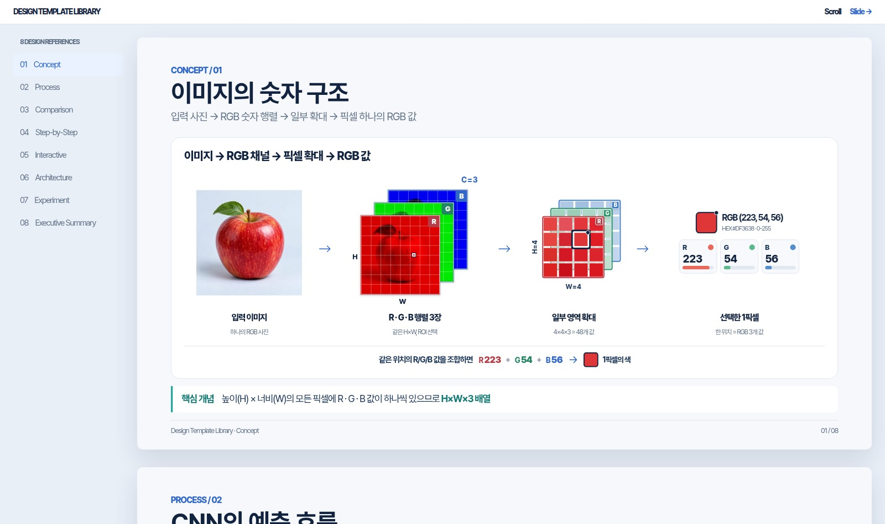
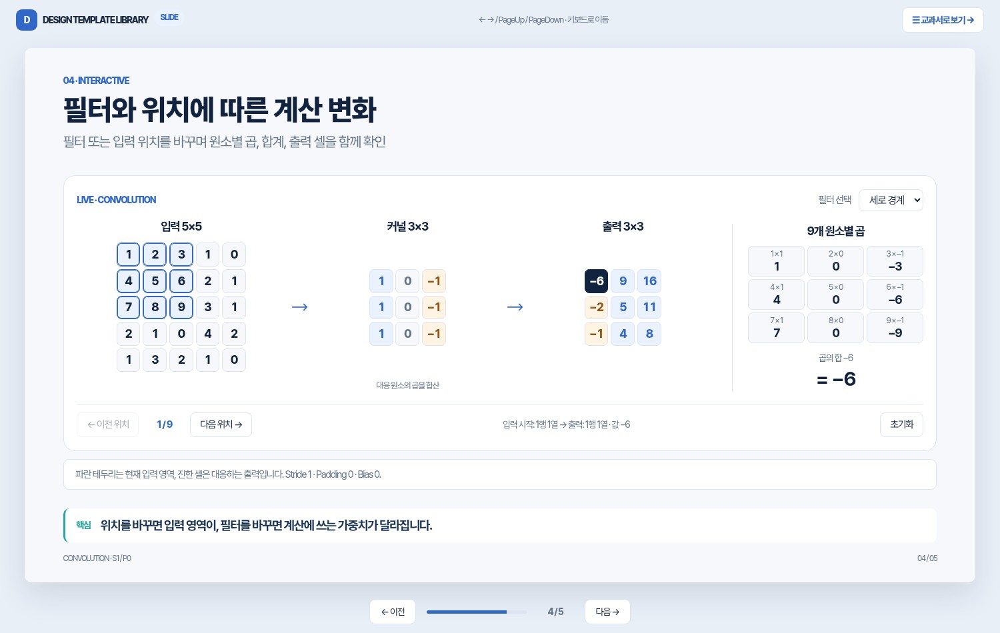

# Template Catalog v0.1

Concept / Process / Comparison 3종과 Scroll / Slide 학습 예제를 함께 다듬는 레퍼런스 라이브러리입니다.

| ID | 목적 | HTML | PPTX | 미리보기 |
| --- | --- | --- | --- | --- |
| `concept` | 개념 + 직관적인 수치 예제 | [concept.html](templates/html/concept.html) | [PPTX](templates/pptx/technical-slide-templates.pptx) · 1장 |  |
| `process` | 입력 → 처리 → 출력 구조 | [process.html](templates/html/process.html) | [PPTX](templates/pptx/technical-slide-templates.pptx) · 2장 |  |
| `comparison` | 방법 비교, 적용 조건과 장단점 | [comparison.html](templates/html/comparison.html) | [PPTX](templates/pptx/technical-slide-templates.pptx) · 3장 |  |

### Concept

- **적합:** 픽셀·텐서, 퍼셉트론, 활성함수, 성능 지표 개념 설명
- **구성:** 설명 45% + 수식·도식 55%
- **주의:** 한 장에 복잡한 수식 여러 개를 우겨 넣지 않기

### Process

- **적합:** 이미지 → CNN → Task Head → Prediction 같은 흐름
- **구성:** 일관된 단계 카드 + 방향성 있는 화살표
- **주의:** 병렬 작업/조건 분기는 단순한 직렬 화살표로 오해시키지 않기

### Comparison

- **적합:** 규칙 기반 vs 머신러닝, 전처리 방법, 평가 기법 비교
- **구성:** 동일한 질문에 대한 양측 답변 + 실제 예제
- **주의:** 조건이 다른 실험 지표를 같은 조건인 것처럼 표시하지 않기

## 추가 후보 (미구현)

`formula`(수식 단계별 계산), `experiment`(그래프·confusion matrix), `section`(장 구분), `architecture`(복잡한 모델 블록), `timeline`(학습·추론 프로세스)

## 기술 상태

- HTML: CSS 공유, 반응형, 별도 의존성 없음
- PPTX: 실제 3장 편집 가능 원본 파일 + Python 재생성 스크립트
- PNG 프리뷰: HTML 실제 브라우저 렌더링 캡처

## Typography (all templates)

All templates, including Concept / Process / Comparison, must use **condensed 1.0 pt** character spacing (`-1pt`) for all text: headings, body, labels, notes and footers. See `DESIGN_SYSTEM.md` and shared HTML/PPTX sources.

## 04 · Dual-mode Learning (Scroll / Slide)

| 모드 | 목적 | 원본 | 실제 렌더링 프리뷰 |
| --- | --- | --- | --- |
| `scroll` | 목차/스크롤/추가 설명이 있는 웹 교과서 | [scroll.html](templates/dual-mode-learning/scroll.html) |  |
| `slide` | 16:9 발표/강의, 키보드 내비게이션 | [slides.html](templates/dual-mode-learning/slides.html) |  |

- **Common design**: [DESIGN_SYSTEM.md](DESIGN_SYSTEM.md) / `templates/html/styles.css` (네이비·블루·틸, 전역 -1pt 자간).
- **Shared source**: [lesson.js](templates/dual-mode-learning/assets/js/lesson.js) · [lab.js](templates/dual-mode-learning/assets/js/lab.js).
- **Instructions**: [DESIGN.md](templates/dual-mode-learning/DESIGN.md) · [MODES.md](templates/dual-mode-learning/MODES.md).
- **Example**: CNN 5×5 입력과 3×3 필터의 연산을 실시간으로 확인하는 학습용 예제. 실제 CNN 학습 결과가 아님.

### 5개 슬라이드 레퍼런스

| 장 | 레퍼런스 유형 | 프리뷰 |
| --- | --- | --- |
| 01 | 픽셀 패턴 · 강조 행렬 | [슬라이드 01](templates/dual-mode-learning/slides.html#motivation) |
| 02 | 국소 계산 · Weight Sharing | [슬라이드 02](templates/dual-mode-learning/slides.html#locality) |
| 03 | 입력 → 필터 → Feature Map | [슬라이드 03](templates/dual-mode-learning/slides.html#pipeline) |
| 04 | 조작 가능한 CNN Lab | [슬라이드 04](templates/dual-mode-learning/slides.html#experiment) |
| 05 | 출력 Feature Map 3종 비교 | [슬라이드 05](templates/dual-mode-learning/slides.html#takeaway) |

3종 기본 레이아웃, 5개 실습 슬라이드, 웹 교과서 모두 디자인 예시로서 지속적으로 수정하며, HTML/PPTX는 해당 형식에 맞게 구현합니다.
