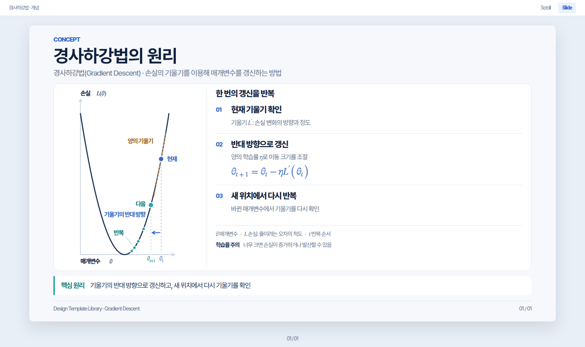

# 경사하강법 · 템플릿 재사용 검증

기존8종과 공통 Markdown으로 새로운 개념 한 장을 제작한 검증 사례입니다. 아홉 번째 canonical 패턴이 아닙니다. 로지스틱 회귀의 소스·개별 설계 문서·검증 스크립트와 이전 대화를 설계 입력으로 사용하지 않았습니다.

- [Slide 보기](slides.html) / [Scroll 보기](scroll.html): 같은 [콘텐츠 원본](content.html) 한 장을 표시
- [구현 전 설계와 출처](DESIGN.md): D0 main `878b9f0`, 설계 선행 커밋 `d27789f`
- [D0/D1 평가와 문제 로그](VALIDATION.md)
- [실제 렌더링 검증 JSON](previews/validation.json)
- [검증기](../../scripts/verify_gradient_descent.py)

저장소 루트에서 실행합니다.

```bash
python -m http.server 8000
# http://localhost:8000/examples/gradient-descent/slides.html
# http://localhost:8000/examples/gradient-descent/scroll.html
```

Python Playwright와 Chromium을 설치한 뒤 `python scripts/verify_gradient_descent.py`로 독립 수학 검산·PC4×두 모드·실제 폰트·화면 경계·모드 전환·실패 안내를 검사하고 프리뷰를 재생성합니다. 시스템 Chromium은 `CHROMIUM_EXECUTABLE` 또는 PATH에서 찾고, 없으면 Playwright Chromium을 사용합니다. 계산·배치를 바꾸면 [DESIGN.md](DESIGN.md)와 프리뷰/JSON도 갱신합니다.

대표 캡처는 두 개입니다. 8개 화면의 전체 PNG는 `/tmp/gradient-descent-review`에 생성하며 CI artifact에도 보관합니다. 작은 PC 창의 Scroll은 세로 스크롤을 허용하고 Slide는 전체 프레임을 화면에 맞춥니다.



[Scroll 실제 Chromium 프리뷰](previews/scroll.png)

공통 규칙의 재사용은 확인했지만 독립 저자의 블라인드 재제작,8종 모든 패턴의 타주제 적용, 모바일·다중 브라우저·실제 학습 수렴은 검증하지 않았습니다.


2026-10-26 사용자 개정: 그래프를345×482px로 좁고 높게 바꾸고 제작용 부가 문구를 제거했다. 실제 곡선의 세로 표시는 종전보다약1.86배이며,16:9 안에서 수식과 제목·Footer를 보존한 비율이다. 라벨과 곡선·상태점·투영선의 충돌 검사까지 통과했다. [8화면 모음](review/contact.jpg)과 [개정 검증 기록](../overfitting-generalization/VALIDATION.md)을 함께 확인할 수 있다.
