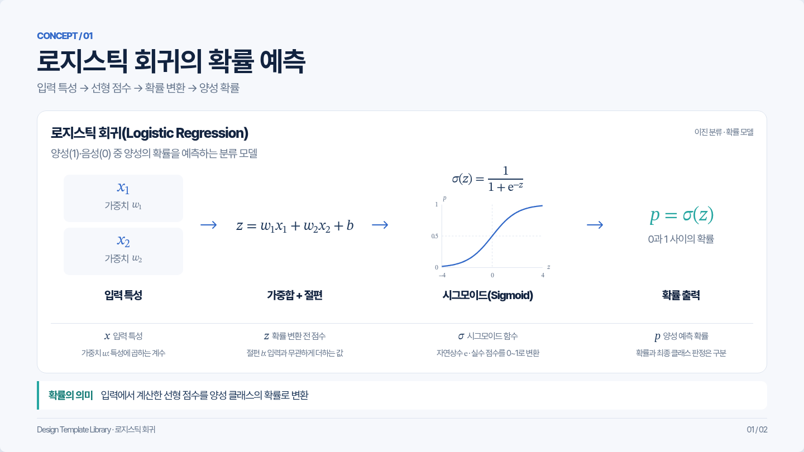
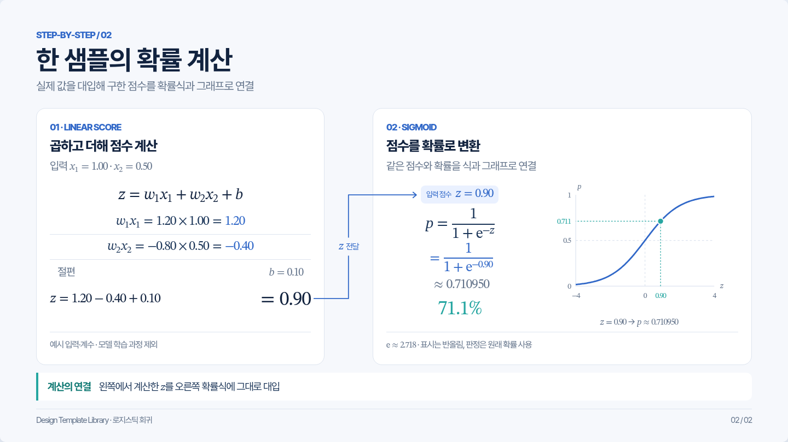
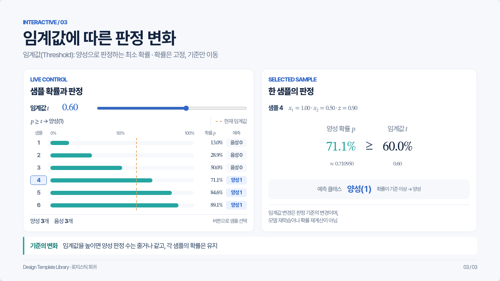

# 로지스틱 회귀 · 본편 2장과 선택 부록

실제 Chromium에서 렌더링한 1440×810 캡처입니다. 실행 가능한 원본과 계산 조건은 [자료 안내](../README.md)를 확인합니다.

## 1. 개념 — 확률 예측

## 2. 계산 — 한 샘플의 확률 계산

## 선택 부록 A — 임계값에 따른 판정 변화

부록은 본편2장의 확률 계산을 이해하는 데 필수인 과정이 아닙니다. 위 부록 이미지는 임계값 0.60·샘플4의 정지 화면입니다. 실습은 [부록 포함 HTML](../slides.html?appendix=1#ref-threshold)을 로컬 서버에서 실행합니다. 기본 [HTML 원본](../slides.html)은 본편2장입니다.
