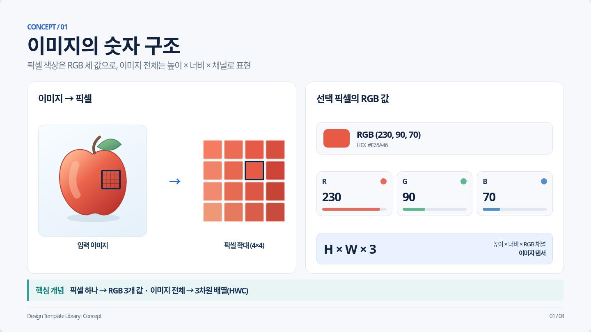
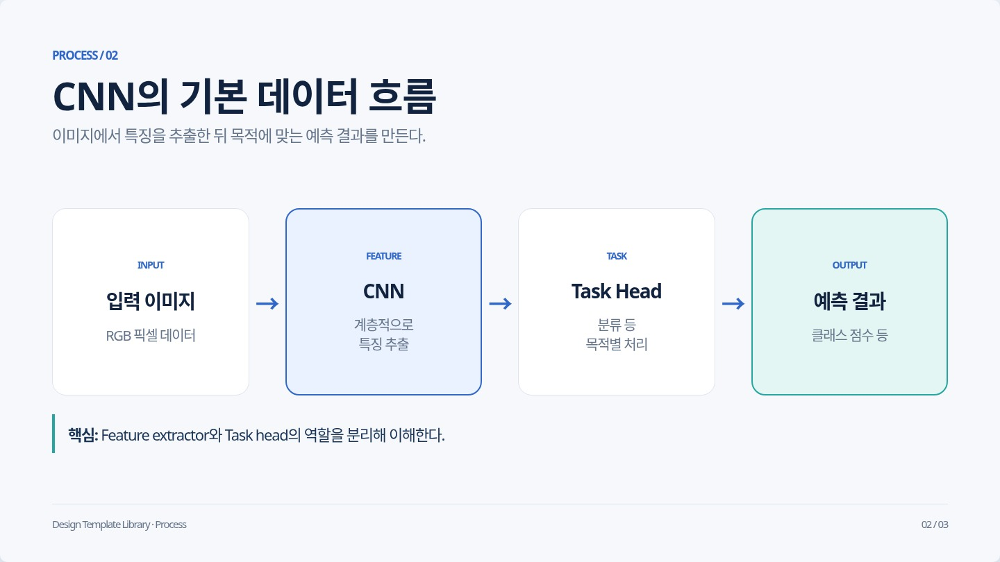
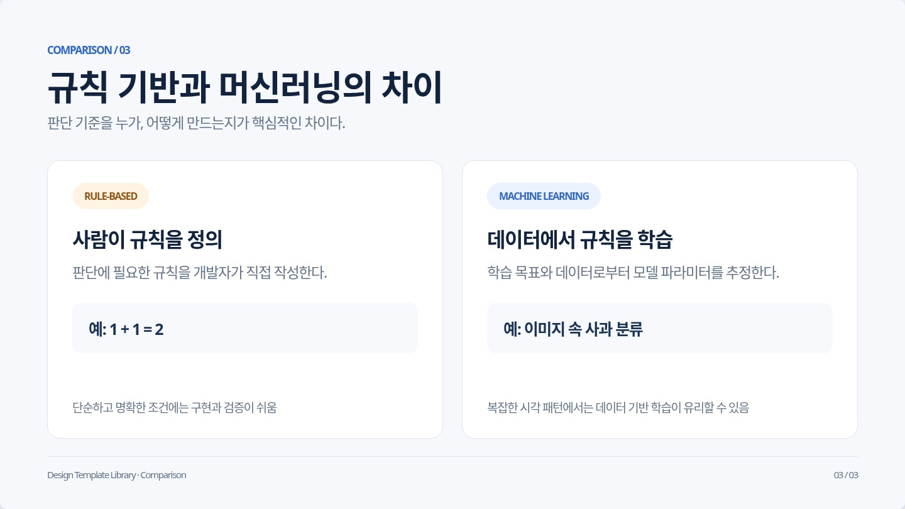
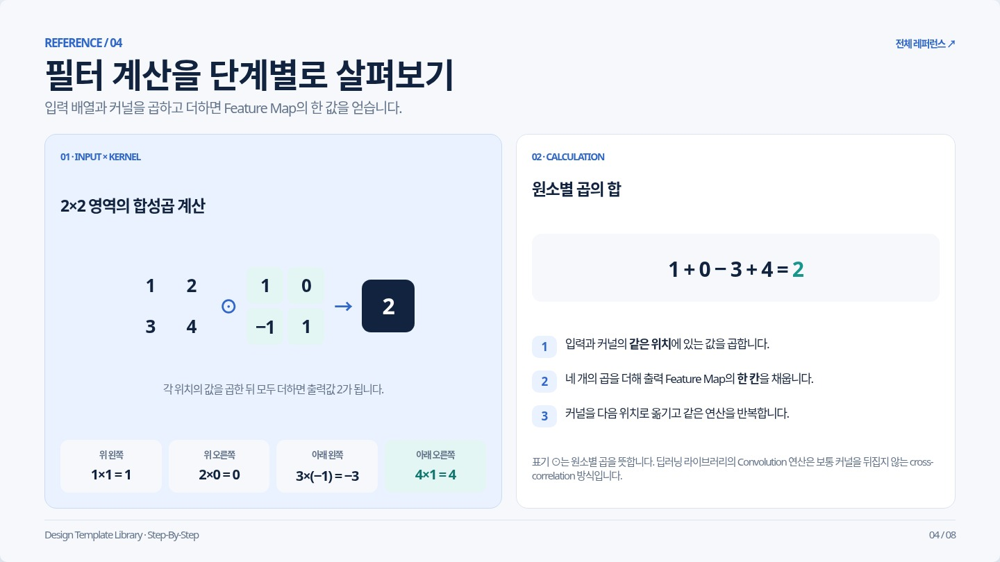
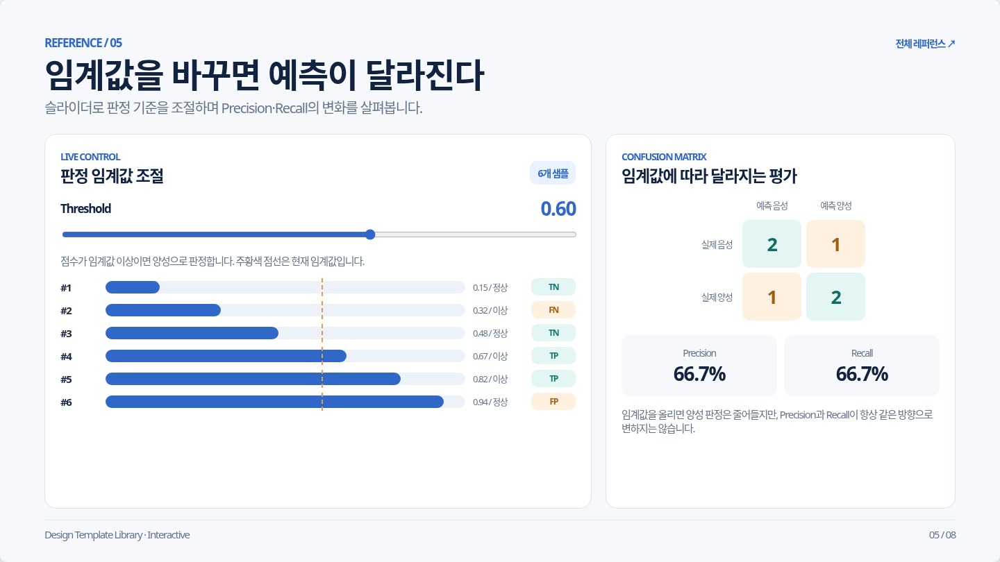
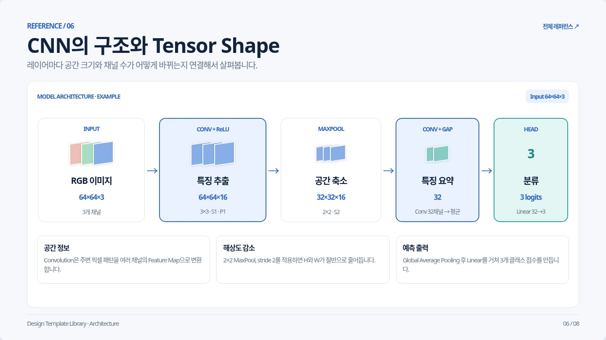
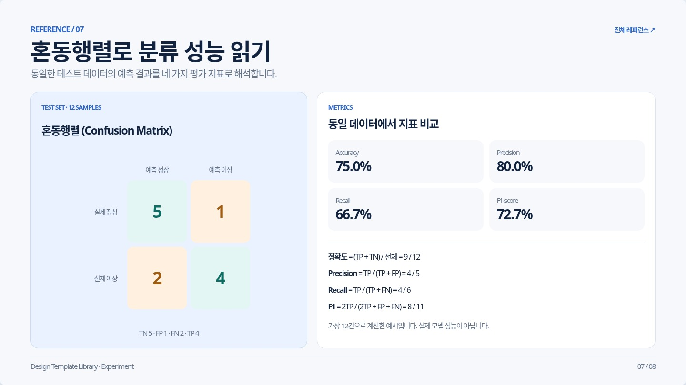
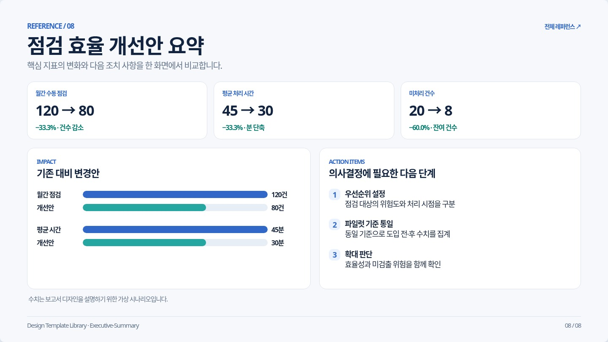

# 8종 Before / After

Before: `main@b123d12`를 1500×950 Chromium에서 직접 렌더링한 1440×810 슬라이드.
After: 같은 브라우저·뷰포트에서 수정본을 직접 렌더링한 결과. Interactive는 임계값 0.60이며 After에는 키보드 검증 후 포커스 표시가 보입니다.

[유형별 검토 보고서](../../docs/REFERENCE_REVIEW_2026-10-21.md) · [40개 화면 검증 기록](validation.json)

| 유형 | Before | After |
| --- | --- | --- |
| 01 concept |  |  |
| 02 process |  |  |
| 03 comparison |  |  |
| 04 step-by-step |  |  |
| 05 interactive |  |  |
| 06 architecture |  |  |
| 07 experiment |  |  |
| 08 executive-summary |  |  |
